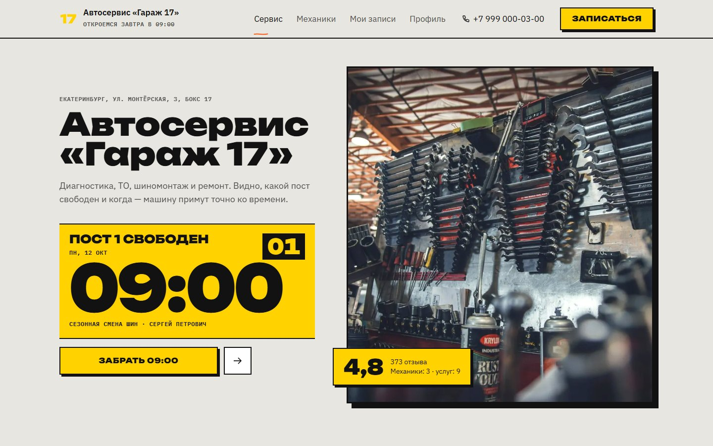
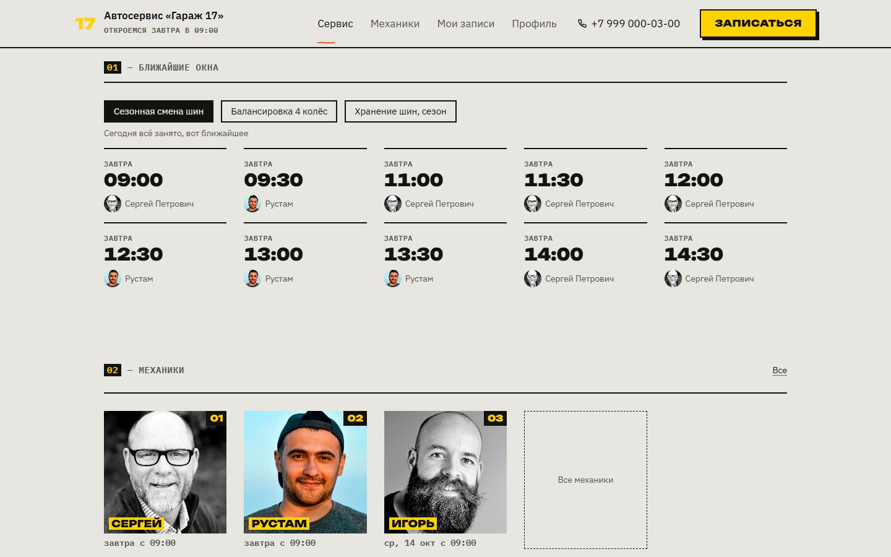
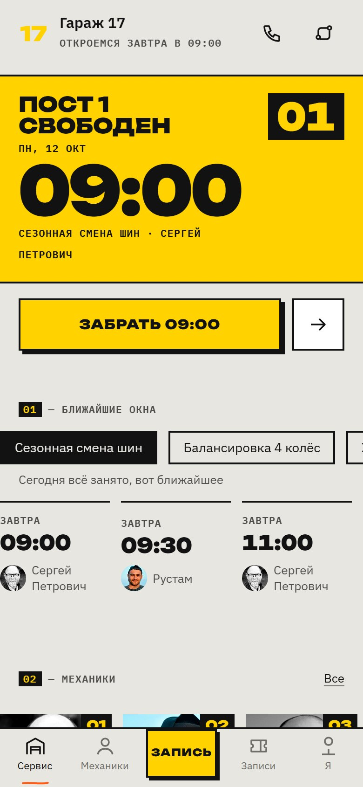
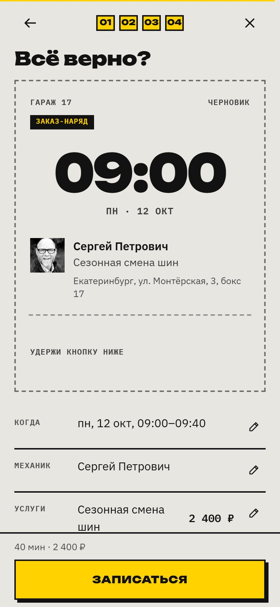
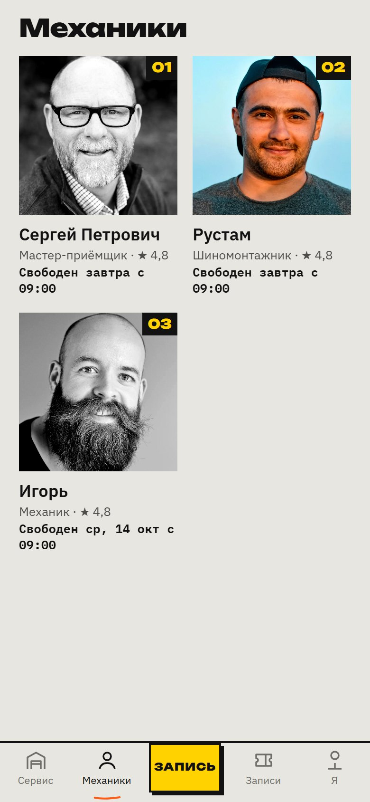
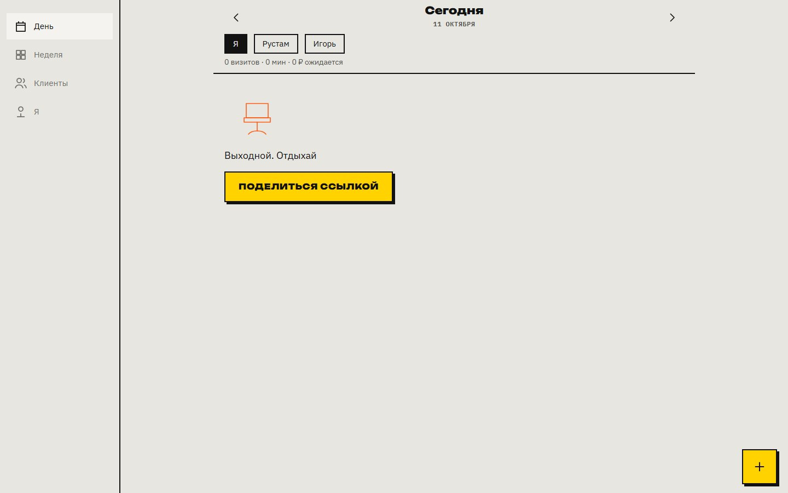
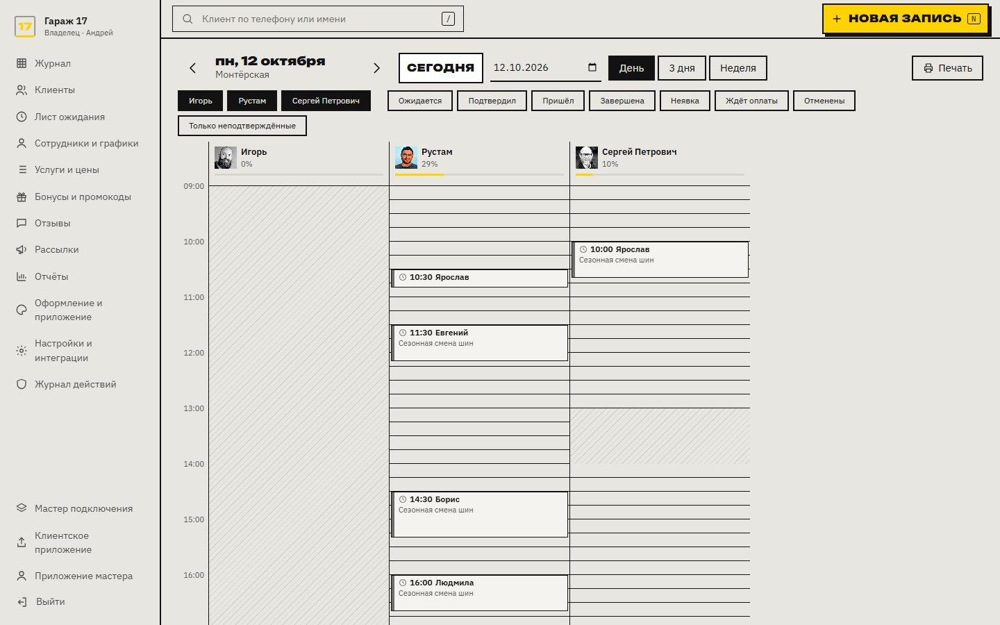
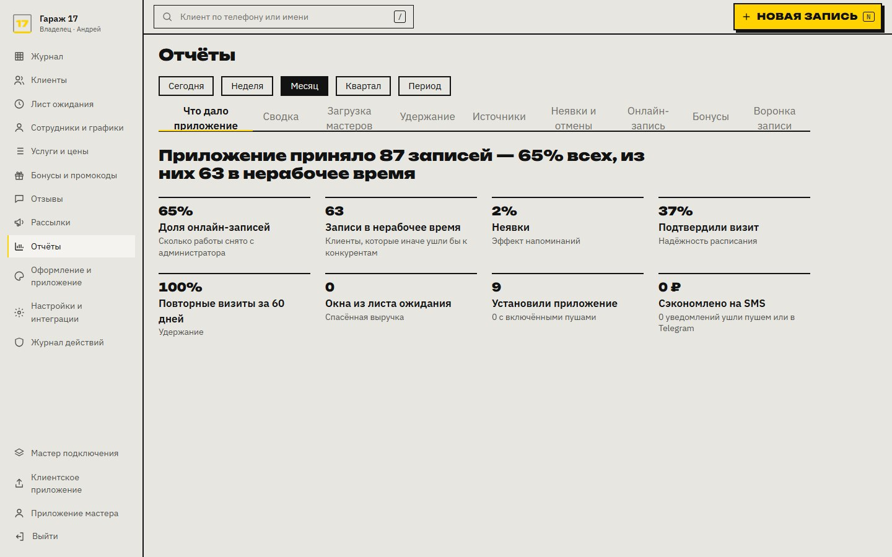

# 🔧 Автосервис «Гараж 17» — онлайн-запись

Демо-проект для портфолио — приложение автосервиса в Екатеринбурге: видно, какой пост свободен и когда, цена шиномонтажа зависит от радиуса колёс, машины клиента хранятся в профиле.
Это один из салонов платформы **«Окно»**: white-label PWA, где у каждого бизнеса своё приложение
со своей иконкой, цветом, шрифтами и тоном текстов (здесь — на «ты»), а внутри три приложения:
для клиентов, для мастеров и панель управления.

### 👉 [Открыть сайт](https://forrerin.github.io/garage17-autoservice/)

Приложение мастера — [garage17-autoservice/master](https://forrerin.github.io/garage17-autoservice/master/), панель владельца — [garage17-autoservice/admin](https://forrerin.github.io/garage17-autoservice/admin/).

  
  

  
  
  

  
  

  

> ⚠️ Салон, люди и отзывы вымышленные. Это демо-версия: всё, что вы делаете (записи, оплаты, отмены),
> сохраняется только в вашем браузере и видно во всех трёх приложениях. Деньги не списываются.

---

## 🚀 Как посмотреть

**Проще всего — [открыть сайт по ссылке](https://forrerin.github.io/garage17-autoservice/).** Работает на компьютере и телефоне;
на телефоне его можно установить на экран как приложение.

### Запустить у себя на компьютере (Windows, 2 шага)

Ничего устанавливать не нужно.

1. **Скачайте проект:** зелёная кнопка **Code** вверху страницы → **Download ZIP** → распакуйте архив в любую папку.
2. **Дважды кликните `start.bat`.** Откроется чёрное окно, а сайт сам откроется в браузере.

> Сайт работает, пока открыто чёрное окно. Закрыли окно — сайт выключился.

---

## 👆 Что попробовать

- **Запишитесь за три касания.** На главной — ближайшее свободное время: «Забрать», войти и удержать кнопку «Записаться».
  Вход в демо — кнопкой **«Войти как Сергей»** или по любому номеру с кодом **4242**.
- **Полный путь записи:** услуги → мастер (или «Любой мастер» — система выберет сама) → лента дня с барабаном времени → подтверждение.
- **Оплата картой:** **«Плановое ТО»** — предоплата 1 000 ₽. Тестовые карты:
  `5555 5555 5555 4477` — оплата проходит, `5555 5555 5555 5599` — банк отказывает. Срок и CVC — любые.
  Отмените запись заранее — предоплата вернётся.
- **Мои записи:** билет с QR-кодом, перенос, «Опаздываю», отмена, отзыв после визита. Бонусы — кешбэк бонусами с уровнями.
- **Приложение мастера** (`/master`, вход как Сергей Петрович, мастер-приёмщик): лента дня, «Клиент пришёл → Завершить», неделя, клиенты с заметками.
- **Панель владельца** (`/admin`, вход как Андрей): журнал по мастерам, клиенты, графики, услуги и цены, бонусы и промокоды,
  отзывы, рассылки, отчёты и «Оформление» — смена цвета и иконки. Ваша запись из клиентского приложения появится в журнале.
- В профиле клиента — **его машины** с госномером и радиусом колёс; прайс шиномонтажа сразу подсвечивает нужный столбец.
- Ресурсы: каждая услуга занимает пост или бокс мойки, двух машин на одном посту в одно время не будет.

На компьютере сайт открывается в полноэкранной версии, на телефоне — как мобильное приложение
с нижним меню. Сравните: просто сузьте окно браузера.

## ❓ Если что-то не так

| Проблема | Решение |
|---|---|
| После двойного клика по `start.bat` окно сразу закрылось | Распакуйте архив полностью (не запускайте из ZIP) и попробуйте снова |
| Windows пишет «Система Windows защитила ваш компьютер» | Нажмите **Подробнее** → **Выполнить в любом случае**. Скрипт только раздаёт файлы из папки `garage17-autoservice` |
| Пишет «Не нашёлся свободный порт» | Закройте другие локальные серверы или перезагрузите компьютер |
| Хочу начать демо заново | Очистите данные сайта в браузере: значок замка слева от адреса → «Настройки сайта» → «Удалить данные» |

---

## Что внутри

- **Три приложения в одном:** клиентское (PWA), приложение мастера и панель управления — у каждого своя иконка и манифест.
- **Движок свободного времени:** графики 5/2 и 2/2, перерывы, отпуска, буферы между клиентами, услуги с паузой,
  «Любой мастер» с распределением нагрузки, визит к нескольким мастерам подряд, посты и боксы как ресурсы.
- **Защита от двойной записи:** холд времени на 5 минут, блокировки и ограничения прямо в базе данных.
- **Тема «Сигнал»: жёлтый и чёрный, как разметка в боксе, жирный гротеск Unbounded.** Анимации с характером темы: билет записи, кнопка с удержанием, рукописные пометки.
- **Уведомления** каскадом: push → Telegram → SMS, тихие часы, напоминания с кнопкой «Приду».
- **Оплата** через ЮKassa, кешбэк и штампы, промокоды, подарочные сертификаты, лист ожидания.

| Часть | Технологии |
|---|---|
| Клиент | React 18, TypeScript, Vite, Framer Motion, TanStack Query, Workbox (PWA) |
| Сервер | NestJS, PostgreSQL 17 (Row-Level Security), Prisma, pg-boss, SSE |
| Интеграции | ЮKassa, Telegram Bot API, SMS.ru, Web Push (VAPID), S3 |

> В этой демо-версии сервера нет: ответы API заранее записаны с настоящего сервера,
> а записи и оплаты обрабатываются прямо в браузере — поэтому сайт работает всегда и бесплатно.

---

## 📄 Права

Это демонстрационная версия: в репозитории лежит только собранный сайт, исходный код проекта не публикуется.
Смотреть и запускать можно, копировать и использовать код, дизайн и тексты — нельзя.
Подробнее в [LICENSE](LICENSE). Фотографии — [Unsplash](https://unsplash.com).
